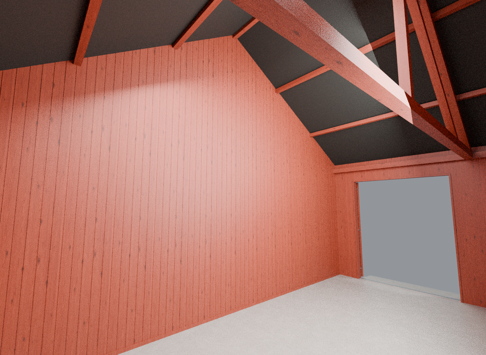
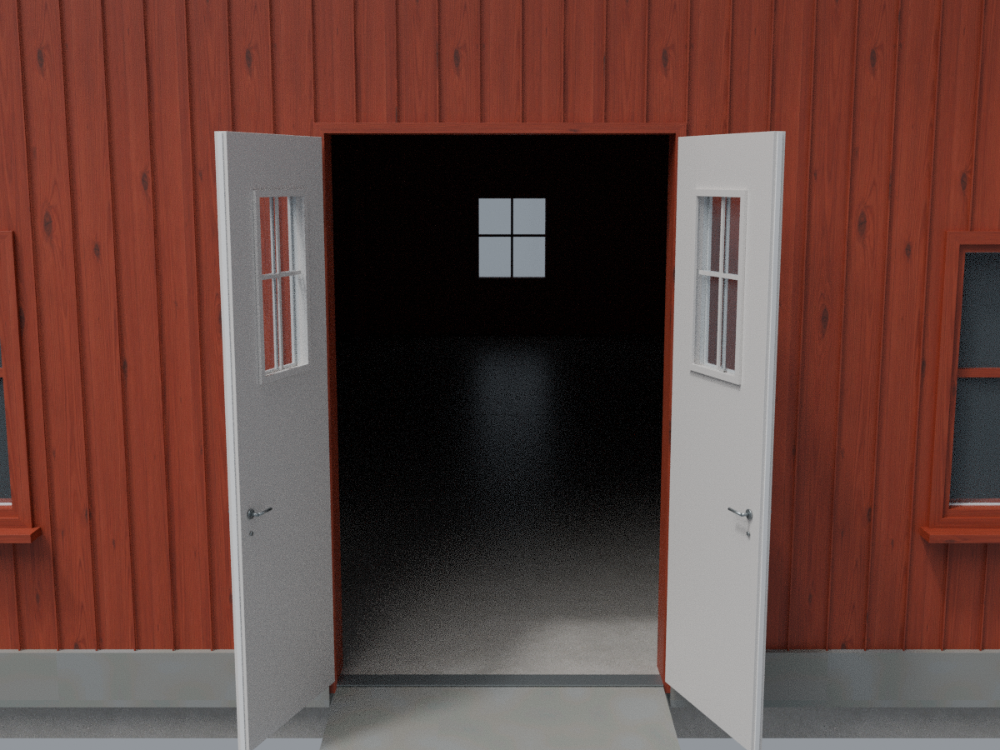

# Norsk låve – v10

Skilleveggen står mellom de to røde portene og går tvers over til bakveggen og helt opp til taket. Den hvite inngangsdøra har nå to separate blad som åpner 110° hver sin vei. Alt rødt treverk er gjort 10 % mørkere.

Alle fem port-/dørbetjeningene har egne bevegelses-, åpenstopp- og lukkelyder. Lydfilene følger med modden.

## Skillevegg

## Hvit dobbel inngangsdør

Bildene er Blender-renderinger med studiobelysning. Versjonen er kontrollert med GIANTS-konverterer og automatiske geometri-/lydfilkontroller, men er ikke spilltestet i FS25.
