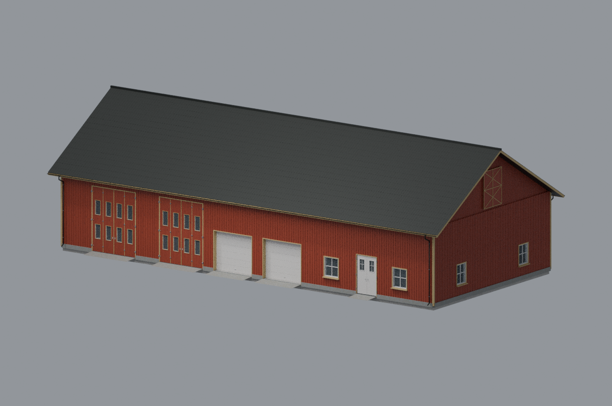
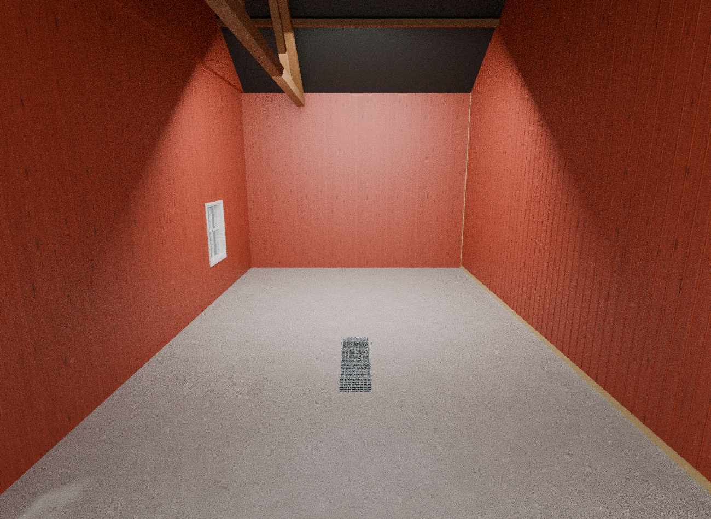
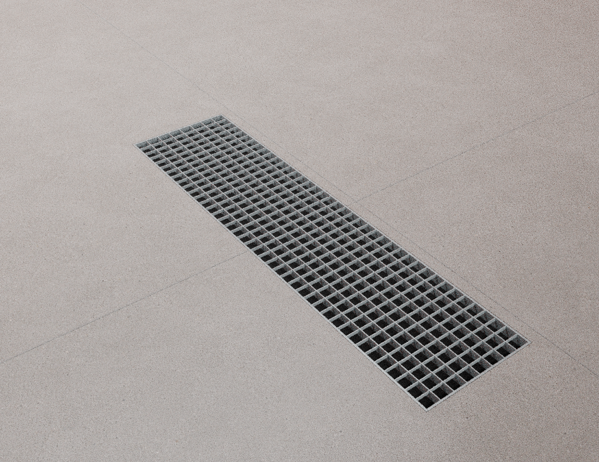

# Norsk låve – v11

Bakveggen i det lille rommet er ryddet og vindusåpningen lukket. Den opplastede verkstedristen er felt ned midt i gulvet. Fargene er tilpasset det opprinnelige låvebildet: rødt panel, lyse lister, hvite karmer/porter og mørkt tak.

## Farger

## Ryddet vegg og rist midt i rommet

## Risten

Bildene er Blender-renderinger med studiobelysning. Modden er teknisk kontrollert, men ikke spilltestet i FS25. Lys og grafikkinnstillinger påvirker fargene og glansen i spillet.
