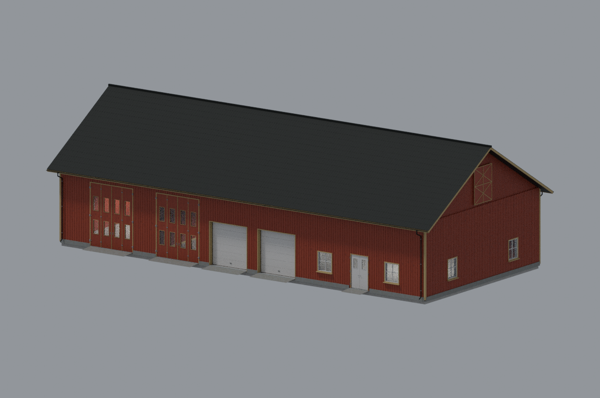
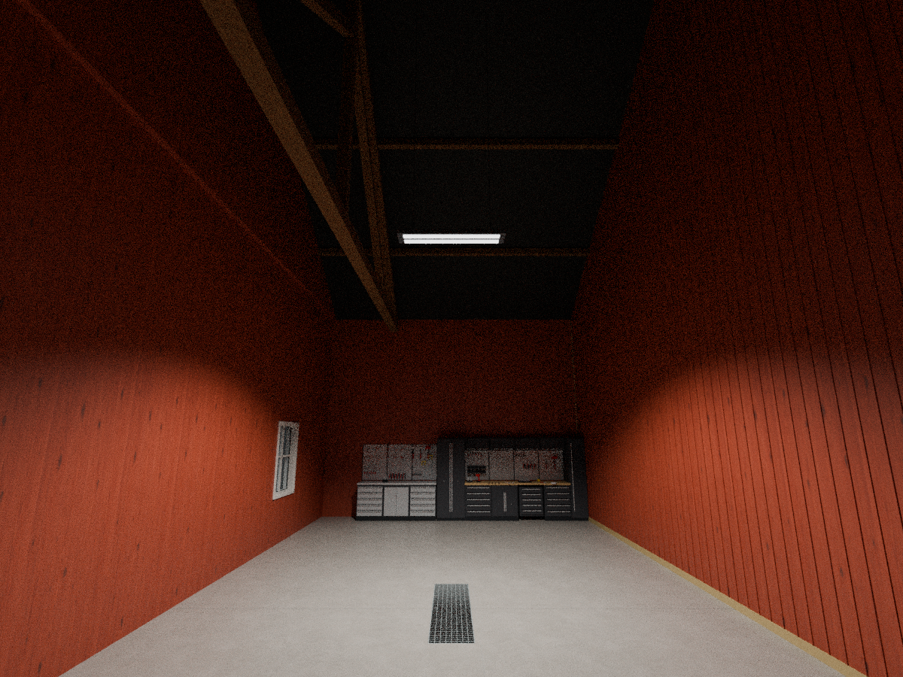
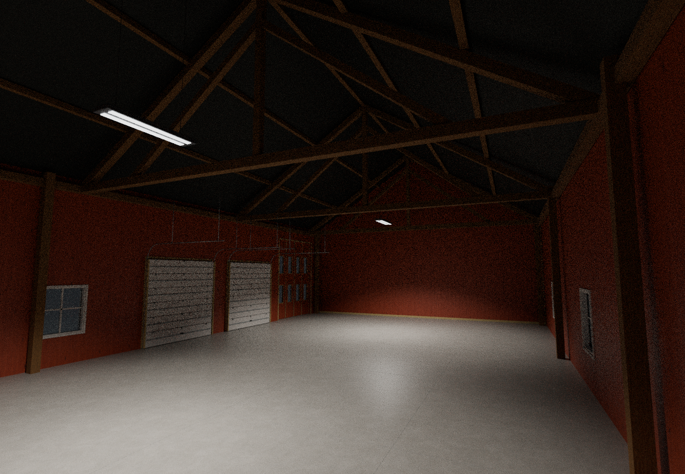

# Norsk låve – v14

Ett takarmatur i det lille rommet og to i det store. Den hvite dobbeldøra er 12 % lavere og smalere; de to hvite leddportene er 12 % høyere. Innredningen er bevart. Verkstedregistreringen dekker hele det lille rommet og kontrollerer kjøretøyenes faktiske plassering.

## Dører og porter

## Ett lys i det lille rommet

## To lys i det store rommet

Blender-renderinger av modellen, ikke skjermbilder fra FS25. Lysnivå og grafikkinnstillinger påvirker utseendet i spillet. Versjonen er teknisk kontrollert, ikke spilltestet.
