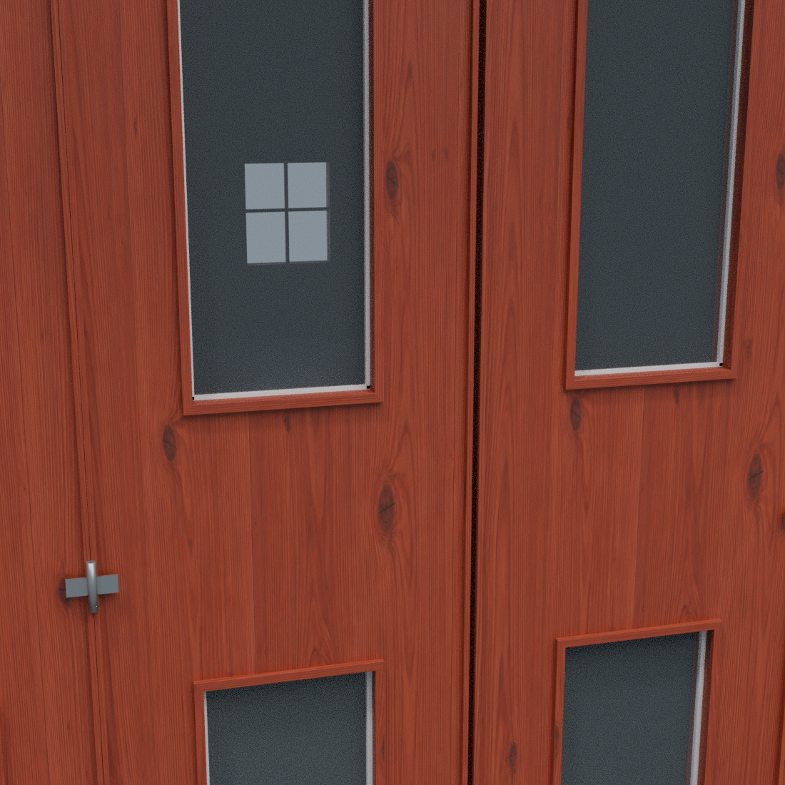
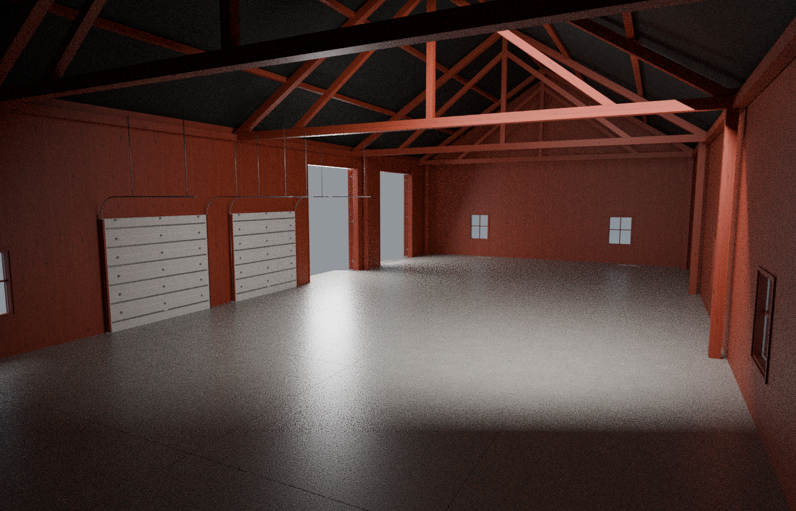

# Norsk låve – materialer v9

Rødbeiset furu med synlige årringer og kvister på treverket, og et slipt betonggulv med svak glans. Portanimasjonene fra v8 er beholdt.

## Treverk

## Gulv og innside

Bildene er Blender-renderinger med studiobelysning. Denne utgaven er ikke spilltestet i FS25; lys og grafikkinnstillinger i spillet påvirker glansen.
