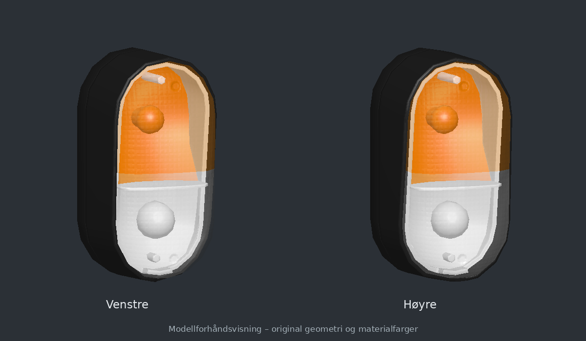

# New Holland T6 – blink- og posisjonslykt

[Last ned prefaben](FS25_T6_Indicator_Prefab.zip?raw=1)

Venstre og høyre variant av den originale ovale lykten fra `FS25_newHollandT6` av Arek. Selve lyktehuset, glasset og lysdelene er skilt ut; resten av traktoren følger ikke med.

Pakk ut ZIP-en og importer `t6IndicatorLeft.i3d` eller `t6IndicatorRight.i3d` i GIANTS Editor 10. Nødvendige teksturer og `vehicle_XML_examples.xml` følger med. XML-eksemplet kobles til kjøretøyets eksisterende lysoppsett; ingen Lua trengs. Se `README_NO.txt` i ZIP-en.

Geometri, UV-er, materialer, filbaner og binærformat er kontrollert mot kilden. GIANTS Editor og FS25 er ikke kjørt her.
